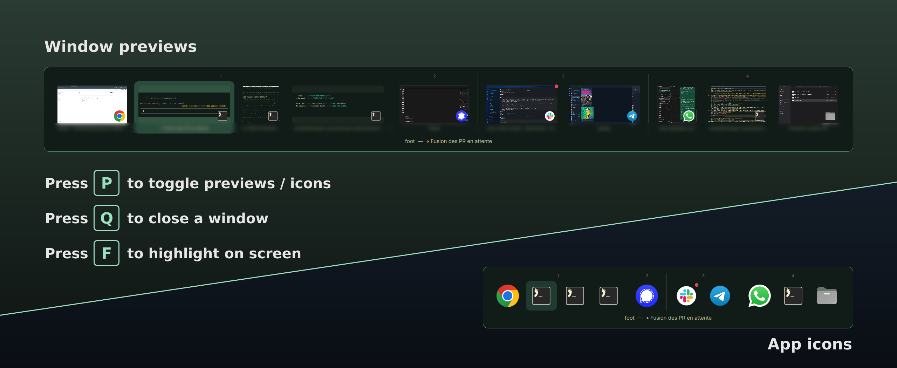
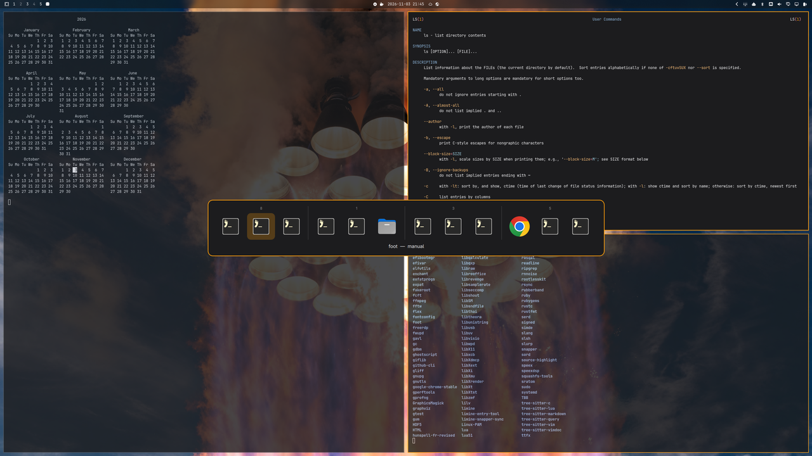
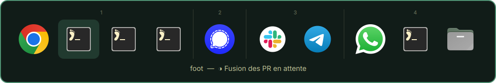
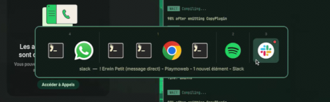

# hyprland-alttab

A visual **Alt+Tab window switcher** for the [Hyprland](https://hyprland.org/) Wayland compositor.

It is an **[Omarchy](https://omarchy.org/) shell plugin** (QML,
hosted by the `omarchy-shell` Quickshell process).



## Features

- 🪟 **Visual switcher** on the layer-shell `Overlay` layer with exclusive keyboard focus
- 🗂️ **Grouped by workspace** (active first), sorted by recency (`focusHistoryID`), pinned windows and special workspaces (`special:*`) excluded
- 🖼️ **Window previews** — a still frame of each window (toplevel screencopy), with its app icon
  as a corner badge and its title underneath, so several windows of the same app are easy to tell
  apart. Icons are resolved from `.desktop` files (id variants, `StartupWMClass`, Omarchy terminal
  app class, launcher URL and whole-word title match for Chrome PWAs) and stand in when a window
  can't be captured. Agent windows (`omarchy agent`) show the agent they run, or the default
  agent, when an icon of that name exists, else the default terminal's icon
- 🔴 **Notification badges** — a red dot on windows whose app sent a notification since you last
  looked at it (optional module, see [Configuration](#configuration))
- 🎨 **Theme-aware** — follows the active Omarchy theme automatically
- ⌨️ Tab/Right → next, Shift+Tab/Left → previous, Return → activate, Escape → cancel, P → toggle previews, F → highlight on screen, Q → close window,
  releasing ALT/SUPER → activate; hover selects, click activates. ALT/SUPER+Shift+Tab opens on the
  last window of the list
- 🫀 Stays open while ALT or SUPER is physically held (verified via `hl.is_key_down` when no
  keyboard event reaches the overlay)

## Install (Omarchy plugin)

```bash
omarchy plugin add https://github.com/c4software/hyprland-alttab --enable
```

For local development, symlink a checkout instead and enable it:

```bash
ln -sfn "$PWD/hyprland-alttab" ~/.config/omarchy/plugins/vbrosseau.alttab
omarchy plugin enable vbrosseau.alttab
```

That's it: the plugin registers its keybindings in Hyprland itself, at
startup and again after every `hyprctl reload`, by evaluating
[`omarchy-plugin/alttab-bindings.lua`](omarchy-plugin/alttab-bindings.lua). That
file holds the four binds (`ALT`/`SUPER`+`TAB` and their `Shift` variants), the
`alttab` submap the overlay switches to while open, and the layer rule. Your
configuration files are left untouched; disabling the plugin reloads Hyprland,
which restores your previous binds.

Note that `ALT+TAB`, `SUPER+TAB` and their `Shift` variants replace Omarchy's
window-cycling and next/previous workspace binds. To keep your own binds
instead, set `"bindings": false` in `~/.config/omarchy/alttab.json` (see
[Configuration](omarchy-plugin/README.md#configuration)).

If you installed an earlier version, your config may already include the file:

```lua
dofile(os.getenv("HOME") .. "/.config/omarchy/plugins/vbrosseau.alttab/omarchy-plugin/alttab-bindings.lua")
```

It keeps working: the plugin sees the binds (by their `"Alt-Tab switcher"`
description) and registers nothing more. You can remove the line and
`hyprctl reload`; the plugin then takes over.

The shortcut must appear in `hyprctl globalshortcuts`. Manual trigger for testing:

```bash
hyprctl dispatch 'hl.dsp.global("omarchy-alttab:next")'
```

### Configuration

App icons are shown by default. Press `P` while the overlay is open to switch between icons
and window previews; the choice is saved to `~/.config/omarchy/alttab.json`. You can also edit that file
directly (applied live, no shell restart needed):

```json
{ "previews": true }
```

Set `"previews": false` or delete the file to go back to icons.

Press `F` while the overlay is open to highlight the selected window on screen: an accent border,
the other windows faded, and the workspace shown follows the selection (without moving focus;
Escape returns to the starting workspace). Off by default, saved to the same file, with the
opacity of the faded windows in percent (10–100, default 80) and the fade duration in milliseconds
(0–2000, default 250, 0 disables the animation):

```json
{ "highlight": true, "fadeOpacity": 80, "fadeDuration": 250 }
```



> Why a separate file? Omarchy's settings UI (the `schema` declared in a plugin manifest) is
> only available to bar widgets; `service` plugins like this one get no settings from the shell.



Optional features live in [`omarchy-plugin/modules/`](omarchy-plugin/modules) and can be turned off
one by one in the same file; a disabled module is not loaded at all:

```json
{ "modules": { "notificationBadges": false } }
```

- `notificationBadges` (on by default): a red dot on windows whose app sent a notification since
  you last looked at it, read from omarchy-shell's notifications (on-screen and history). Chromium
  web apps (WhatsApp, Outlook…) are matched through the site Chromium puts in the notification;
  a notification from a regular browser tab gets no badge.



See [`omarchy-plugin/README.md`](omarchy-plugin/README.md) for details.

### Uninstall

If your Hyprland config still includes `alttab-bindings.lua` (earlier
versions), first remove that `dofile` line (or the binds and layer rule, if you
pasted them by hand) and `hyprctl reload` — once the plugin is removed, the
`dofile` target no longer exists and Hyprland reports a config error. Then:

```bash
omarchy plugin remove vbrosseau.alttab --yes
```

The plugin never modifies your configuration files itself.

## License

[MIT](LICENSE)
